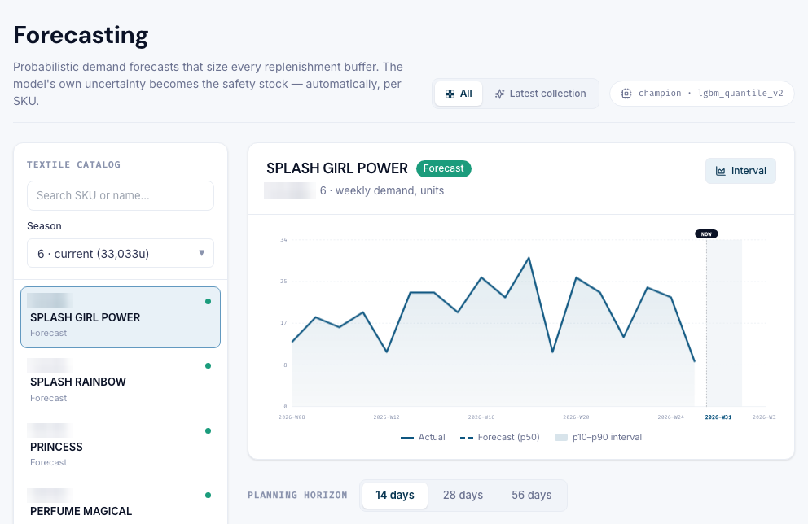
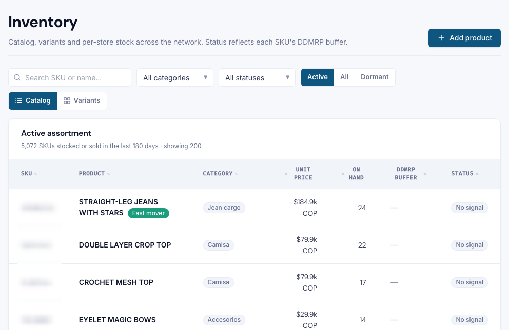
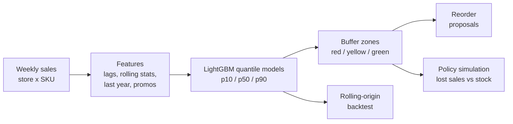
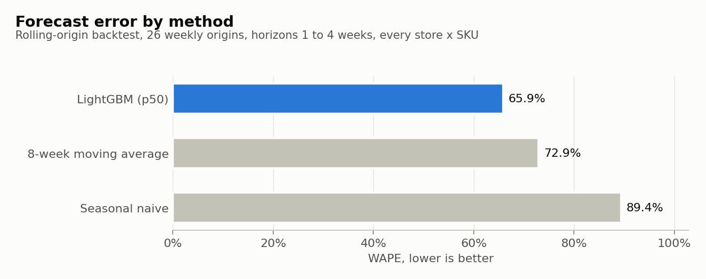
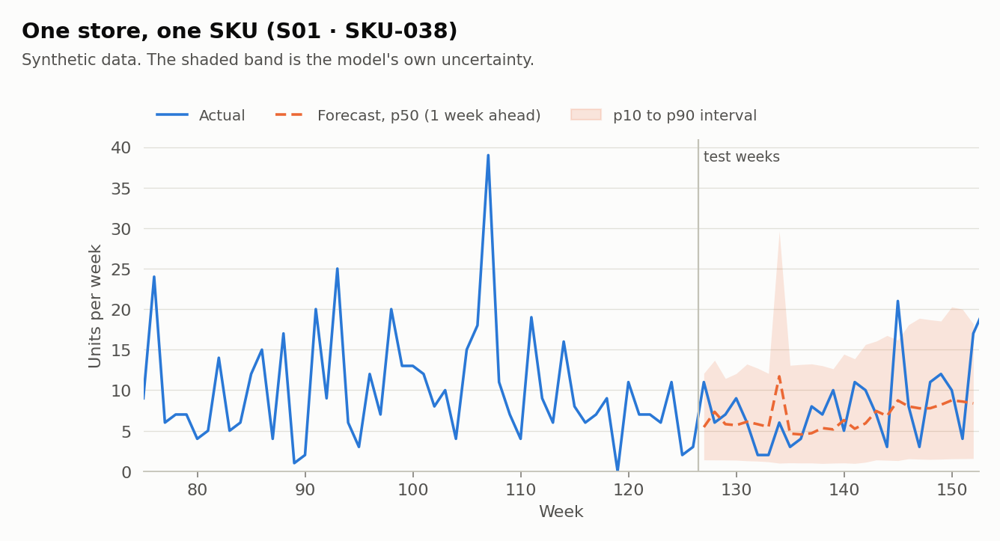
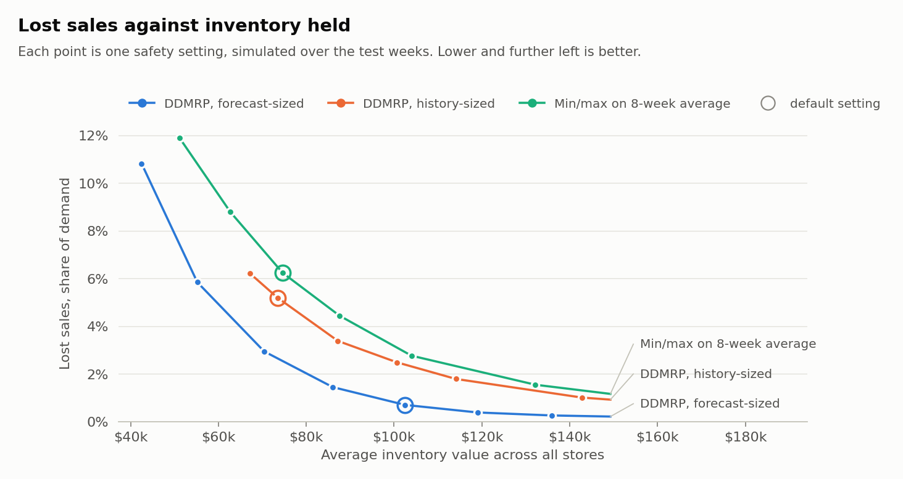
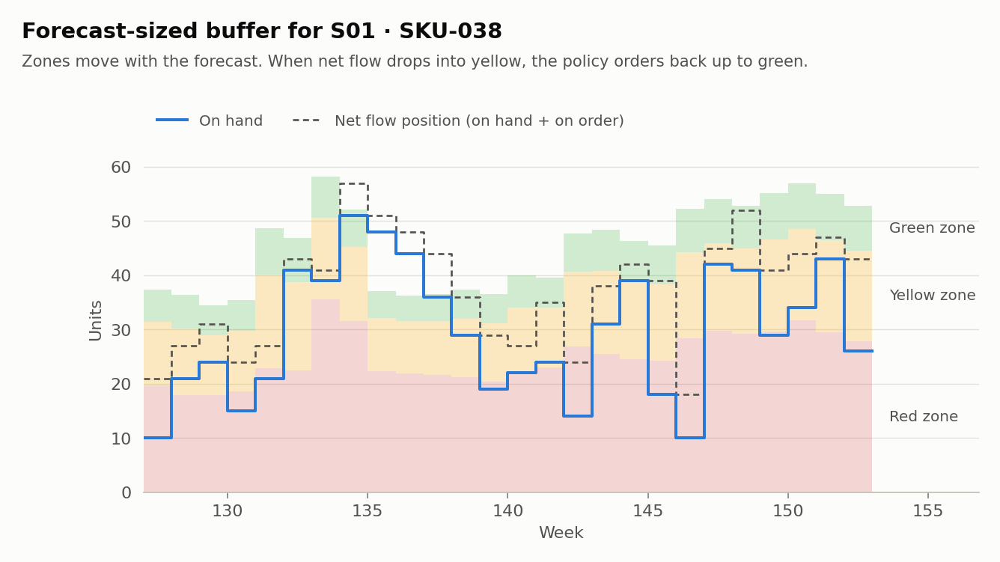
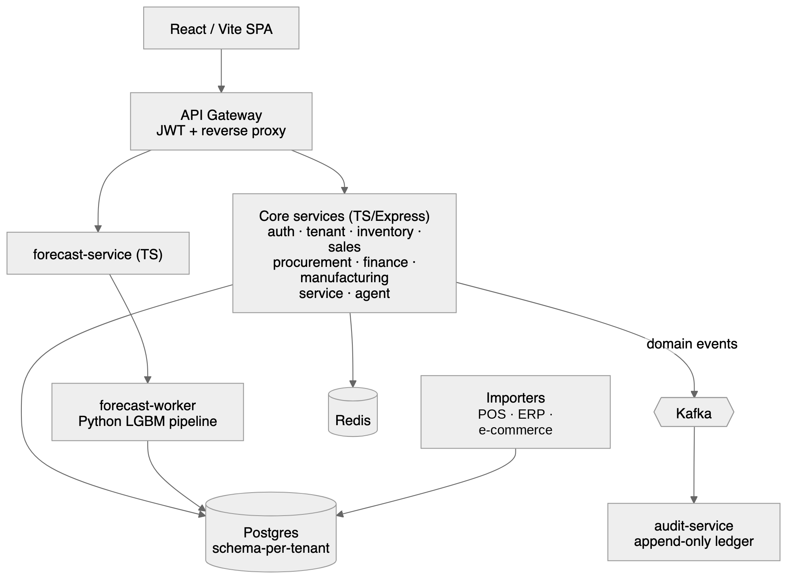

# Store-level demand forecasting and reorder buffers

[](https://github.com/jdumit1/demand-forecasting-reorder-buffers/actions/workflows/ci.yml)


Your POS knows what sold. It doesn't know what each store should reorder next week.

This repo is a runnable version of the layer I build for that: demand forecasts per store and SKU, with their uncertainty, and reorder buffers sized from that uncertainty. I run the same approach in production for a multi-store apparel retailer and an auto dealer network. Their data and code are private, so **everything here runs on generated data**. The screenshots below are from the production system, with SKU codes and some product names blurred.

## In production

<p>
  
  
</p>

Left: weekly demand per SKU with the p10 to p90 interval that sizes the safety stock. Right: catalog and per-store stock, with each SKU's buffer status. The same screen flags dormant stock (SKUs with stock and no sale in 180 days) as clearance candidates.

Results from the production work: on a backtest of store-level apparel sales, the model cut forecast error (WAPE) **about 15%** against the method it replaced, and it went to production. In a backtest simulation on an auto-parts network, per-store buffers cut stockout-plus-holding cost **38%**, at 36% more average inventory. Those are the numbers to quote. The numbers further down come from synthetic data and only show that the pipeline works end to end.

## What this repo does



1. **Generate** 480 store x SKU series over 156 weeks ([`synth.py`](src/storecast/synth.py)): fast movers and a long tail of slow ones, category seasonality, holiday peaks, chain-wide promotions, mid-history launches. Mean demand is 1.9 units per week and 41% of weeks sell nothing, close to what store-level apparel data looks like.
2. **Forecast** 1 to 4 weeks ahead with one global LightGBM model per quantile ([`features.py`](src/storecast/features.py), [`model.py`](src/storecast/model.py)). Features are scaled per series so fast and slow movers train together.
3. **Backtest** with rolling origins ([`backtest.py`](src/storecast/backtest.py)): at each of 26 weekly origins the model retrains only on weeks that have already happened, then forecasts every series. A test checks that no future week leaks into training.
4. **Size buffers** the DDMRP way, except that red safety comes from the forecast's own p90 to p50 gap instead of a fixed variability factor ([`buffers.py`](src/storecast/buffers.py)).
5. **Simulate** 26 weeks of ordering under three policies, with a 2-week lead time and lost sales on stockouts ([`simulate.py`](src/storecast/simulate.py)), then sweep each policy's safety setting to compare them at equal inventory.

## Results on synthetic data

### Forecast accuracy



| Method | WAPE | Bias |
|---|---:|---:|
| LightGBM, p50 | 65.9% | -19.8% |
| 8-week moving average | 72.9% | +1.3% |
| Seasonal naive (same week last year) | 89.4% | -4.8% |

The model cuts WAPE by about 10% against the best baseline. WAPE looks high in absolute terms because a single store sells about 2 units of a SKU per week, and at that volume most of the error is noise no model can predict. That is why the interval matters as much as the point forecast. The p10 to p90 interval covers 85% of actual weeks against a target of 80%, so it is slightly wide.

The p50 is a median. On skewed, intermittent demand the median sits below the mean, so it reads about 20% low on total volume. WAPE rewards the median, which is why it wins here. The buffer adds the p90 to p50 gap on top, so the reorder policy does not inherit that bias. Sizing the yellow zone from a mean forecast is a natural next step.



### Reorder policies

Three policies place a weekly order for every store and SKU:

- **Min/max on 8-week average**: reorder when stock plus open orders falls below the lead time plus one week of trailing average sales; order up to two weeks above that. This is the kind of rule built into many POS systems.
- **DDMRP, history-sized**: standard DDMRP zones from the trailing average, with a fixed variability factor of 0.5.
- **DDMRP, forecast-sized**: the same zones, sized from the quantile forecast.

At default settings:

| Policy | Fill rate | Lost units | Avg inventory value | Holding cost | Lost margin | Total cost |
|---|---:|---:|---:|---:|---:|---:|
| Min/max on 8-week average | 93.8% | 1,695 | $74,630 | $9,329 | $44,433 | $53,762 |
| DDMRP, history-sized | 94.8% | 1,412 | $73,460 | $9,182 | $36,895 | $46,078 |
| DDMRP, forecast-sized | 99.3% | 190 | $102,509 | $12,814 | $4,500 | $17,314 |

The forecast-sized policy loses far fewer sales, but it also holds more stock, so the table alone doesn't show whether the forecast helps or the policy just buys more. The sweep below separates the two: each policy's safety setting goes from lean to generous, and each point is a full simulation. The chart stops at twice the default min/max inventory, where all three curves flatten out; the full sweep is in the results folder.



- **At the same inventory as default min/max ($74,630)**, lost sales fall from 6.2% to 2.5% of demand with forecast-sized buffers, and to 5.0% with history-sized DDMRP.
- **With each policy tuned to its own lowest total cost**, forecast-sized buffers cost 35% less than the best min/max setting ($17,314 vs $26,619).



Full numbers are in [`results/summary.md`](results/summary.md) and [`results/metrics.json`](results/metrics.json); the sweep is in [`results/frontier.csv`](results/frontier.csv).

## How the buffers are sized

All quantities are units per week, for one store and SKU, recalculated every week from the latest forecast.

| Zone | Formula |
|---|---|
| Average weekly usage (AWU) | mean of the p50 forecast over the next 4 weeks |
| Red base | AWU x lead time x 0.5 (DDMRP's medium lead-time factor) |
| Red safety | sum over the lead time of (p90 - p50) |
| Yellow | AWU x lead time |
| Green | max(AWU x order cycle, red base, minimum order) |

When the net flow position (on hand plus on order) falls to the top of yellow or below, the policy orders back up to the top of green. A SKU the model is unsure about gets a bigger red zone automatically; a steady one gets a small one.

## Run it

```bash
git clone https://github.com/jdumit1/demand-forecasting-reorder-buffers.git
cd demand-forecasting-reorder-buffers
python -m venv .venv && source .venv/bin/activate
pip install -e ".[dev]"

python -m storecast            # full run, a few minutes: rewrites results/ and docs/img/
python -m storecast --quick    # small run, a few seconds
pytest                         # 25 tests
```

Everything is seeded, so a full run reproduces the numbers above.

```
src/storecast/
  synth.py       synthetic sales generator
  features.py    lag, rolling, seasonal and promo features; per-series scaling
  model.py       LightGBM quantile models and the two baselines
  backtest.py    rolling-origin backtest; WAPE, bias, pinball loss, coverage
  buffers.py     DDMRP-style zones sized from the forecast
  simulate.py    weekly ordering simulation and the policy sweep
  plots.py       the charts in this README
  cli.py         python -m storecast
tests/           metrics, buffer arithmetic, leakage, simulation invariants
results/         metrics from the last full run
```

## Limits

- **Synthetic data flatters the model.** The generator and the model share assumptions: a known promo calendar, smooth seasonality, no data errors. Real data has returns, stock-outs that hide demand, renamed SKUs and late POS syncs, so expect smaller gains. The production numbers above are the honest ones.
- **One echelon.** Stores order with a fixed 2-week lead time and no warehouse, case packs or budget limits. Real deployments usually need some of those.
- **Lost sales, not backorders.** Unmet demand is gone, which fits store retail but not B2B.

## How it fits into the production system



In production a Python forecast worker runs this kind of pipeline for each client. Importers bring in sales and stock from POS, ERP and e-commerce systems, and the forecasts and buffers land in Postgres (one schema per client), where planners see them in the app.

## About

I'm Juan Manuel, a freelance ML engineer based in Madrid. I build demand forecasting, AI agents on business data, and POS, ERP and Shopify integrations. If your stores are reordering from gut feel or a moving average, [message me on Upwork](https://www.upwork.com/freelancers/~0191f050e9f7debaf6).

MIT licensed. No client data or client code is included.
